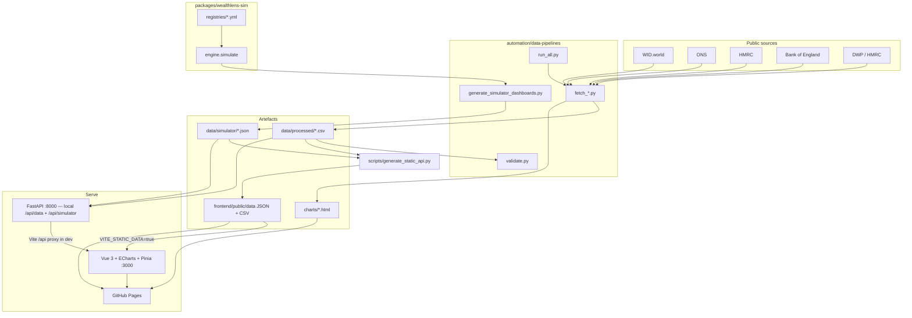

# WealthLens UK

**Source-cited UK wealth-inequality charts, tools, and a policy microsim — built to be read, reused, and argued with.**

[](https://github.com/Chris0Jeky/wealthlens-hq/actions/workflows/deploy.yml)
[](https://github.com/Chris0Jeky/wealthlens-hq/actions/workflows/ci-backend.yml)
[](https://github.com/Chris0Jeky/wealthlens-hq/actions/workflows/ci-frontend.yml)
[](https://github.com/Chris0Jeky/wealthlens-hq/actions/workflows/ci-sim.yml)
[](https://github.com/Chris0Jeky/wealthlens-hq/actions/workflows/ci-pipelines.yml)
[](https://github.com/Chris0Jeky/wealthlens-hq/actions/workflows/codeql.yml)
[](LICENSING.md)
[](https://www.python.org/downloads/)
[](https://nodejs.org/)

## What this is

WealthLens HQ is the public command-centre monorepo for **WealthLens UK**: a source-cited dashboard of UK wealth inequality, the Python pipelines that feed it, and `wealthlens-sim`, an open policy microsimulation library.

The public site is a Vue 3 app on GitHub Pages. Every chart cites a source, URL, and access date. WAS-derived charts carry the June 2025 accreditation-loss caveat. The live FastAPI process is for local development; production serves prerendered HTML plus static JSON/CSV generated at deploy time.

I built this because the official numbers exist — ONS, HMRC, WID, BoE, DWP — and then disappear into spreadsheets, PDFs, and paywalled notes. The job is not to editorialize them. It is to put them on a URL you can open, cite, embed, and check.

**Live site:** [chris0jeky.github.io/wealthlens-hq](https://chris0jeky.github.io/wealthlens-hq/)

## Features

Shipped in this repo, not planned:

- **Twelve interactive chart routes** (`/charts/:name`), each with a source bar and methodology note. The flagship pages (`wealth-shares`, `productivity-pay`, `gdhi-by-region`, `tax-composition`, `boe-rates`, `child-poverty`, `generational-wealth`) use a broadsheet article layout; the other five currently use a simpler title-plus-chart layout.
- **Chrome-free embeds** at `/embed/:name` for third-party iframes, plus a wired share bar and static CSV mirrors for most datasets (generational-wealth CSV is withheld pending a licence decision).
- **Interactive tools:** wealth scale (`/tools/wealth-scale`), household-wealth comparator (`/tools/wealth-calculator`), income-tax calculator (`/tools/tax-calculator`), and a wealth-tax band explorer (`/tools/wealth-tax-simulator`).
- **Policy microsim** (`packages/wealthlens-sim/`): `engine.simulate` scores seven reform families (A–G) against a synthetic GB population, with provenance manifests on published numbers. The public `/simulator` page currently serves two illustrative annual wealth-tax scenarios from precomputed JSON — not live engine calls, and not official forecasts.
- **Reproducible fetch/process pipelines** from WID, ONS, HMRC, BoE and DWP into CSV + Plotly HTML. `run_all.py` is the single script list; a fetch failure is supposed to fail closed rather than publish partial data.
- **Dark mode**, skip-to-content, keyboard-accessible tabs and controls, and WCAG AA as a contribution rule (axe-checked in frontend tests).
- **Dataset + methodology pages** that share one provenance table (`datasetProvenance.ts`).

### Chart index

| Slug | Page | Source |
| --- | --- | --- |
| `wealth-shares` | Top 1% / top 10% net personal wealth, 1820–2024 | WID.world |
| `housing-affordability` | House price to earnings by region | ONS |
| `cgt-concentration` | Capital gains by size of gain | HMRC |
| `wealth-by-decile` | Total household wealth by decile | ONS WAS |
| `wage-stagnation` | Median real weekly earnings | ONS ASHE |
| `inheritance-tax` | Estates liable for IHT | HMRC |
| `productivity-pay` | Productivity vs real pay | ONS |
| `gdhi-by-region` | Gross disposable household income per head | ONS |
| `tax-composition` | UK tax receipts by source | HMRC |
| `boe-rates` | Bank Rate and CPI | Bank of England |
| `child-poverty` | Child poverty after housing costs, by region | DWP / HMRC |
| `generational-wealth` | Median wealth by generation at equivalent ages | Resolution Foundation / ONS WAS |

WAS-derived pages (`wealth-by-decile`, `generational-wealth`, and the wealth tools) include the [accreditation-loss caveat](research/methodology/was-caveats.md).

## Architecture

Sources on the left, GitHub Pages on the right. Repo paths match the tree below.



Production deploy ([`.github/workflows/deploy.yml`](.github/workflows/deploy.yml)) runs the fetch scripts, regenerates the static API, builds the Vue app with `VITE_STATIC_DATA=true`, copies the Plotly gallery into `dist/charts`, prerenders routes ([ADR 0001](docs/adr/0001-dashboard-route-prerendering.md)), and publishes to Pages. There is no application server on the live site.

### Layout

```
wealthlens-hq/
├── projects/wealthlens-dashboard/
│   ├── frontend/                 # Vue 3 + TypeScript + Pinia + Tailwind + ECharts
│   ├── backend/                  # FastAPI (CSV → JSON; simulator fixtures)
│   ├── charts/                   # Static Plotly HTML (copied into the Pages build)
│   └── data/                     # processed/ is gitignored; regenerate locally
├── packages/wealthlens-sim/      # AGPL microsim; entry point engine.simulate
├── registries/                   # sources.yml, assumptions.yml, baselines.yml
├── automation/data-pipelines/    # fetch_*.py, run_all.py, validate.py
├── automation/social-media/      # chart_to_social.py (PNG export sizes)
├── scripts/generate_static_api.py
├── docs/                         # architecture, ADRs, product RFCs, licensing notes
├── research/                     # data-source registry, methodology (WAS caveats)
├── tasks/                        # sprint board + inbox
└── .github/workflows/            # ci-backend, ci-frontend, ci-sim, ci-pipelines,
                                  # CodeQL, e2e, lighthouse, deploy
```

`projects/wealthlens-analyst/` is a pointer only. The Analyst RAG app lives in [`Chris0Jeky/wealthlens-analyst`](https://github.com/Chris0Jeky/wealthlens-analyst).

## Quick start

Prerequisites: **Python 3.11+**, **Node 22** (what CI installs), Git, and GNU Make. On Windows use Git Bash and pass `PYTHON=python` to Make — a bare `make` can pick the Windows Store Python stub and exit 49.

### Frontend only (committed static data)

The Pages-shaped path. Uses the JSON/CSV already in `frontend/public/data/`; no backend and no live fetch.

```bash
git clone https://github.com/Chris0Jeky/wealthlens-hq.git
cd wealthlens-hq
cd projects/wealthlens-dashboard/frontend
npm install
VITE_STATIC_DATA=true npm run dev    # http://localhost:3000/wealthlens-hq/
```

Vite's `base` is `/wealthlens-hq/`, matching GitHub Pages. Open that path, not `/`.

### Full stack (API + live CSVs)

Processed CSVs live under `projects/wealthlens-dashboard/data/processed/` and are gitignored. The API reads them from disk; without a pipeline run, dataset endpoints return 503.

```bash
cd wealthlens-hq
python3 -m venv .venv
source .venv/bin/activate            # Windows: .venv\Scripts\activate
pip install -e ".[dev,pipelines]"
pip install -r projects/wealthlens-dashboard/backend/requirements-dev.txt

make pipelines                       # network; or: python automation/data-pipelines/run_all.py
make dev-backend                     # http://127.0.0.1:8000  (OpenAPI at /docs)
```

In another terminal:

```bash
make frontend-dev                    # http://localhost:3000 — Vite proxies /api → :8000
```

`make help` lists the rest. Useful gates:

| Command | What it actually runs |
| --- | --- |
| `make ci-quick` | backend ruff + mypy + pytest |
| `make frontend-test` | Vitest (`npm run test`) |
| `make frontend-typecheck` | `vue-tsc -b --noEmit --force` |
| `make pipeline-test` | offline pipeline unit tests |
| `cd packages/wealthlens-sim && python -m pytest -q` | simulator package tests |

`vue-tsc` without `-b` is not a typecheck here: the root `tsconfig.json` is project-references only. Keep `-b`. Prefer `npx vitest run` over `npm test` if you keep scratch files under `frontend/src` — `npm test` runs `pretest`, which `git clean`s ignored shadows in that tree.

Pipelines need the network and currently known-broken upstream fetches are tracked in [#494](https://github.com/Chris0Jeky/wealthlens-hq/issues/494). The weekly cron is off; refresh is `workflow_dispatch`. The site serves last-good committed static data.

## Tech stack

| Layer | What is actually in the manifests |
| --- | --- |
| Frontend | Vue 3, TypeScript, Vue Router, Pinia, Tailwind CSS 4, ECharts (via vue-echarts), Vite. Node 22 in CI. |
| Backend | FastAPI, Pydantic v2, Uvicorn, Pandas. Serves CSV from disk — no SQLite/Postgres in this repo. |
| Pipelines | Python 3.11+, Pandas, Requests, Plotly, openpyxl, odfpy |
| Simulator | numpy, pandas, scipy, pydantic, PyYAML. Tested on Python 3.11 and 3.12; 90% coverage gate in `ci-sim`. |
| Hosting | GitHub Pages + GitHub Actions (`deploy.yml`). Route prerender with Playwright/Chromium. |
| Quality | ruff, mypy, bandit, pytest, ESLint, vue-tsc, Vitest, Playwright e2e, Lighthouse CI, CodeQL |

## API

Local FastAPI only. Start it with `make dev-backend`, then [Swagger UI](http://127.0.0.1:8000/docs) or [ReDoc](http://127.0.0.1:8000/redoc). CORS defaults to the Vite origin; override with `CORS_ORIGINS`. In-memory rate limiting is **off** unless `RATE_LIMIT_ENABLED` is set.

On GitHub Pages the same payloads are static files under [`/wealthlens-hq/data/`](https://chris0jeky.github.io/wealthlens-hq/data/datasets.json).

| Method | Path | Notes |
| --- | --- | --- |
| GET | `/health` | Liveness (`status: ok`) |
| GET | `/api/health/data` | Per-dataset CSV presence |
| GET | `/api/version` | Public version + dataset count |
| GET | `/api/data/` | Dataset name list |
| GET | `/api/data/metadata` | Citations for every dataset |
| GET | `/api/data/freshness` | mtime-based fresh/stale/expired |
| GET | `/api/data/{name}` | Paginated rows (`page`, `limit` ≤ 1000) |
| GET | `/api/data/{name}/metadata` | One dataset, with source URL + access date |
| GET | `/api/data/{name}/columns` | dtype / null / unique |
| GET | `/api/data/{name}/summary` | Numeric descriptives |
| GET | `/api/data/{name}/download` | Streaming CSV |
| GET | `/api/simulator/` | Published scenario list (currently two) |
| GET | `/api/simulator/scenarios/{id}` | Dashboard JSON (intervals, caveats, provenance) |

`GET /api/version/debug` exists for local/staging and 404s in production-like `APP_ENV`. `inheritance-tax` is a committed static dataset: it is not in the backend `DATASETS` map and is not produced by `fetch_*.py`.

## Status and roadmap

Public dashboard is live at v0.1.0 (`pyproject.toml`). The simulator package is `0.1.0.dev0` (PyPI classifier Pre-Alpha): the engine and families A–G are implemented; the site publishes two synthetic-population scenarios.

Honest gaps, from the repo rather than a pitch deck:

- Weekly pipeline cron is disabled after repeated upstream fetch failures ([#494](https://github.com/Chris0Jeky/wealthlens-hq/issues/494)). Manual `workflow_dispatch` remains.
- Custom domain `wealthlens.uk` is **planned**, not registered. `SITE_URL` is the GitHub Pages origin until it is.
- Analyst RAG was extracted to [`wealthlens-analyst`](https://github.com/Chris0Jeky/wealthlens-analyst) on 2026-07-06.
- Product sequence after the launch/outreach bundle is documented in [`docs/product/PRODUCT_FRONTIER_2026-07.md`](docs/product/PRODUCT_FRONTIER_2026-07.md): finish chart reuse (RFC-001), then citable data packages (RFC-002) and the data-health layer (RFC-007). Do not treat the anti-portfolio in that doc as a backlog.

Sprint board: [`tasks/active-sprint.md`](tasks/active-sprint.md).

## Data principles

- Every public figure cites source + URL + access date. No fabricated statistics.
- Charts are mobile-responsive and held to WCAG AA.
- Pipelines are meant to be replayable from the listed fetch scripts. Licence and access records live in [`docs/data-licences.md`](docs/data-licences.md) and [`research/data-sources/data-source-registry.md`](research/data-sources/data-source-registry.md).
- Data first, opinion second. Independent, non-partisan, no party affiliation.

## Contributing

Contributions are welcome. Read [CONTRIBUTING.md](CONTRIBUTING.md) (setup, branch names, commit subjects `<area>: <imperative summary>`) and the [Code of Conduct](CODE_OF_CONDUCT.md).

Good first work:

- Add or verify a row in the data-source registry / `docs/data-licences.md`
- Improve a chart's accessibility or methodology note
- Add tests around an existing pipeline or view
- Build a small chart from a cited dataset that is not yet routed

`make ci-quick` is the pre-push minimum. Frontend PRs also run Vitest, `vue-tsc -b`, ESLint, Playwright e2e, and Lighthouse in CI.

LLM-assisted patches are expected in this repo and still need a human review before merge. Policy: [`docs/AI_LLM_DISCLOSURE.md`](docs/AI_LLM_DISCLOSURE.md).

## Security

Do **not** open a public issue for a vulnerability. Email **jeky.tck@gmail.com** as described in [SECURITY.md](SECURITY.md). Secrets never belong in this tree, including "temporary" keys in docs.

## Licence

Dashboard, API, and data pipelines: [GPL-3.0-only](LICENSE). Simulator core (`packages/wealthlens-sim/`): [AGPL-3.0-or-later](packages/wealthlens-sim/LICENSE). Documentation and registries: [CC-BY-4.0](https://creativecommons.org/licenses/by/4.0/). Synthetic public datasets: CC0-1.0 unless a source notice says otherwise. Source datasets keep their own licences (typically OGL v3.0 or CC-BY).

The software boundary moved from MIT to GPL-3.0-only on 12 August 2026. See [LICENSING.md](LICENSING.md), [RELICENSING.md](RELICENSING.md), and [LICENSES/MIT.txt](LICENSES/MIT.txt).

## Links

- Live dashboard: <https://chris0jeky.github.io/wealthlens-hq/>
- Architecture notes: [docs/ARCHITECTURE.md](docs/ARCHITECTURE.md)
- Simulator package: [packages/wealthlens-sim/README.md](packages/wealthlens-sim/README.md)
- Product frontier / RFC sequence: [docs/product/PRODUCT_FRONTIER_2026-07.md](docs/product/PRODUCT_FRONTIER_2026-07.md)
- WAS caveat: [research/methodology/was-caveats.md](research/methodology/was-caveats.md)
- Analyst (extracted): [Chris0Jeky/wealthlens-analyst](https://github.com/Chris0Jeky/wealthlens-analyst)
- Agent map for contributors working in-repo: [AGENT_MAP.md](AGENT_MAP.md)

---

Built by [Chris](https://github.com/Chris0Jeky) in London.
